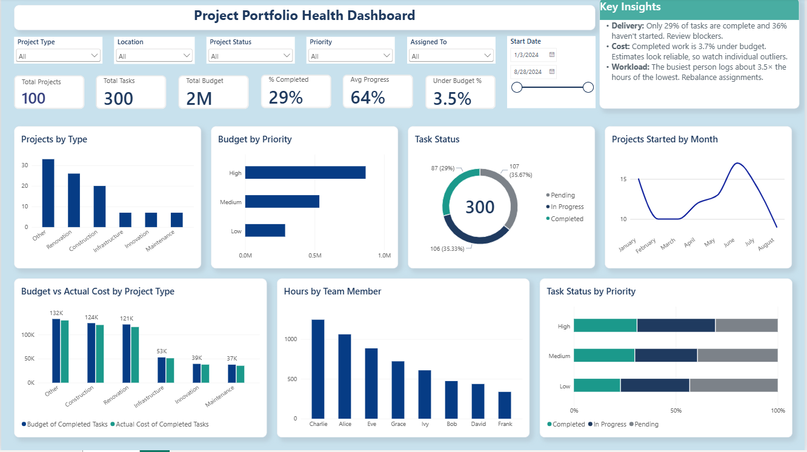

# Project Portfolio Health Dashboard (Power BI)



## Business question
Where is project delivery slipping, and what should a PMO do about it?

## Audience
A Head of PMO who needs a quick view of delivery progress, cost performance and team workload.

## Dataset
Sample project management dataset (100 projects, 300 tasks) from Hugging Face: [add the dataset link here].
The data is synthetic and used for learning purposes only.

## What's in the dashboard
- 6 KPI cards: Total Projects, Total Tasks, Total Budget, % Completed, Avg Progress, Under Budget %
- 6 slicers: Project Type, Location, Project Status, Priority, Assigned To, Start Date
- 6 visuals: Projects by Type, Budget by Priority, Task Status, Projects Started by Month, Budget vs Actual Cost, Hours by Team Member, Task Status by Priority
- A Key Insights panel with findings and recommendations

## Key DAX measures
```DAX
% Tasks Completed = DIVIDE([Completed Tasks], [Total Tasks])

Budget of Completed Tasks =
CALCULATE(SUM(Projects[Budget]), Projects[Task Status] = "Completed")

Actual Cost of Completed Tasks =
CALCULATE(SUM(Projects[Actual Cost]), Projects[Task Status] = "Completed")

Cost Variance = [Budget of Completed Tasks] - [Actual Cost of Completed Tasks]
Cost Variance % = DIVIDE([Cost Variance], [Budget of Completed Tasks])
```

## Data issue and how I handled it
Actual Cost is 0 for tasks that are not completed. Comparing total budget to total actual cost would make the project look hugely underspent, so cost measures use completed tasks only.

## Key insights
- **Delivery:** only 29% of tasks are complete and 36% haven't started, so early blocker reviews would help.
- **Cost:** completed work came in about 3.5% under budget, so estimating looks reliable, though individual outliers need watching.
- **Workload:** the busiest team member logged almost 3.7x the hours of the least busy, so assignments should be rebalanced.

## How to open
Download `Project_Portfolio_Health.pbix` and open it in Power BI Desktop (free).

## Tools
Power BI, DAX, Power Query

